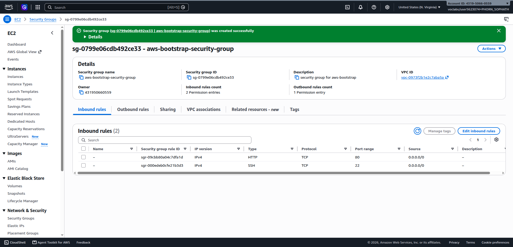
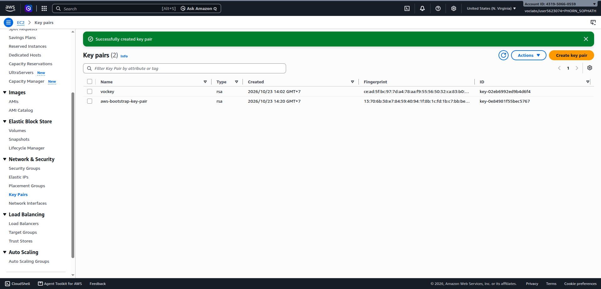
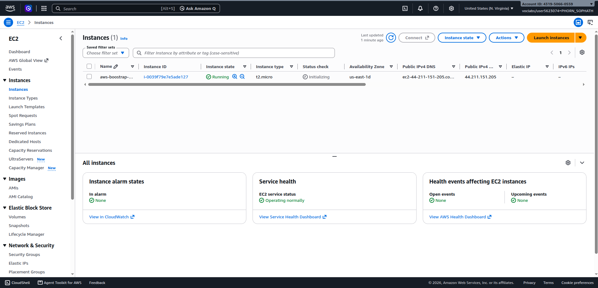
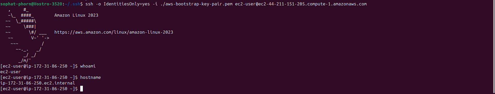
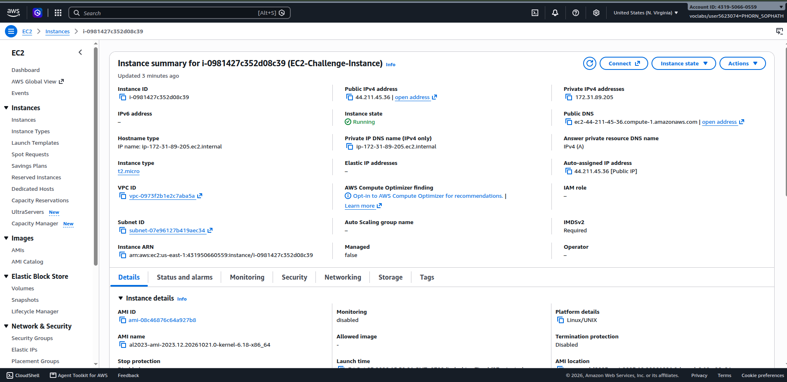
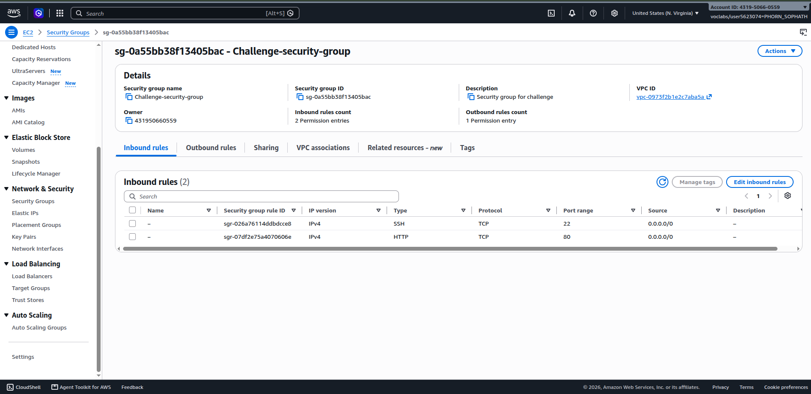
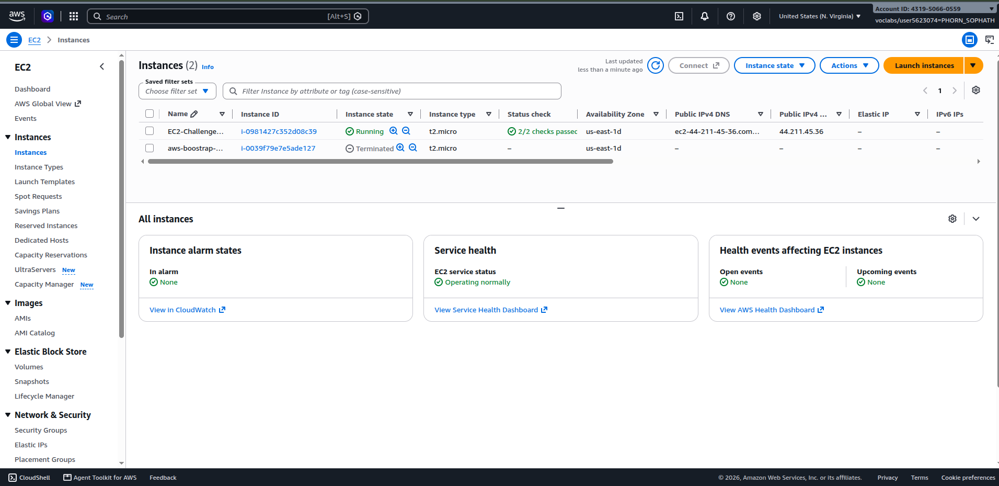
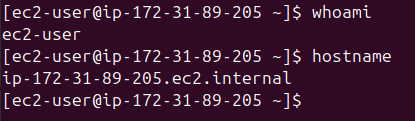
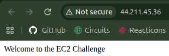

# Cloud Lab 1 — Amazon EC2

> A practical walkthrough of launching, connecting to, and serving a web page from an Amazon EC2 instance.

## Student information

| Field | Details |
| --- | --- |
| **Student name** | PHORN Sophath |
| **Student ID** | `e20220628` |
| **Learner Lab username** | `PHORN_SOPHATH` |
| **Date completed** | 23 October 2026 |

## Contents

- [Part 1.1 — EC2 walkthrough](#part-11--ec2-walkthrough)
- [Part 1.2 — EC2 web solution challenge](#part-12--ec2-web-solution-challenge)
- [Reflection questions](#reflection-questions)

---

## Part 1.1 — EC2 walkthrough

### 1. Create a security group



### 2. Create a key pair



### 3. Configure the instance




### 4. Test the web server in a browser


### 5. Connect to the instance with SSH



**Connection method:** EC2 Instance Connect

---

## Part 1.2 — EC2 web solution challenge

### 1. Launch configuration




### 2. Configure the challenge security group



### 3. Verify the running instance



### 4. Run commands on the instance

The web server was installed and the page was created from the instance terminal.



> **Commands used**
>
> Add the installation and `index.html` creation commands here if a text copy is required in addition to the screenshot.

### 5. Test the challenge website

The page displayed the following message:

> **Welcome to the EC2 Challenge**



---

## Reflection questions

### 1. Security group rules

The **SSH rule** allows secure remote administration of the instance over SSH, normally on port `22`. The **HTTP rule** allows web browser traffic to reach the web server over port `80`. If the HTTP rule were deleted, the web server could still be running, but the page would no longer be reachable through its public HTTP address.

### 2. Installing the web server in Part 1.1

The web server was installed automatically by the EC2 instance's startup configuration, such as its user data script. The script ran during the instance's first boot, so no interactive login was needed.

### 3. HTTP and HTTPS

The page opens with `http://` because the instance is configured to serve unencrypted HTTP traffic on port `80`. HTTPS requires TLS configuration, a certificate, and an HTTPS listener (normally on port `443`), none of which were configured for this exercise.

### 4. Root volume size

The root volume was set to **10 GiB** in the launch configuration under **Configure storage**. After the instance starts, its size can be checked in the EC2 console under the instance's **Storage** tab, or from the instance with a disk-usage command such as:

```bash
lsblk
```