# Cloud Lab 2 Submission — Load Balancer and Auto Scaling

- **Student name:** PHORN Sophath
- **Student ID:** `e20220628`
- **Learner Lab user name:** `PHORN_SOPHATH`
- **Date completed:** 30 October 2026

---

## Security groups

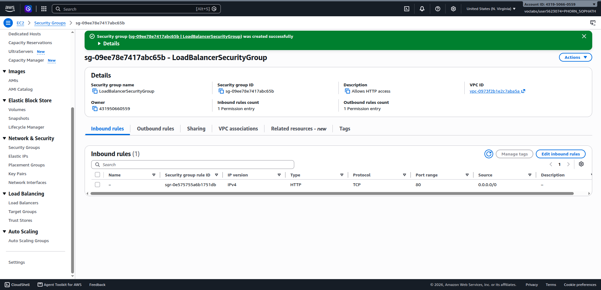

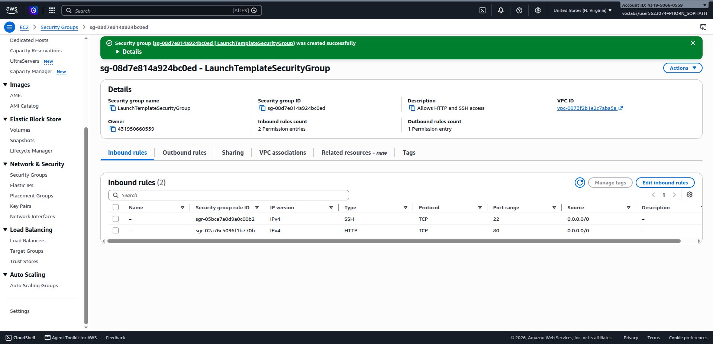

## Target group

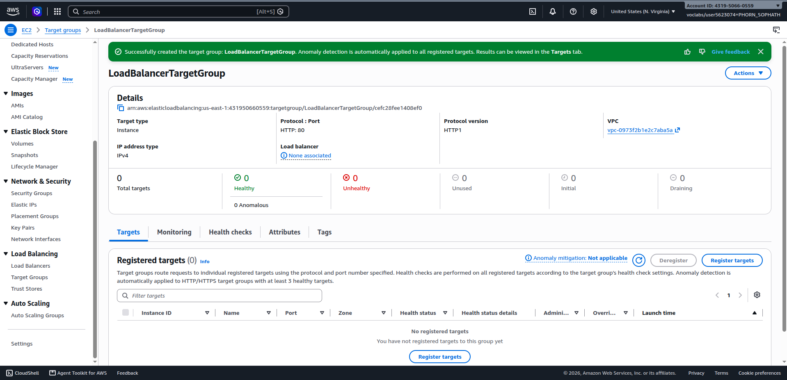

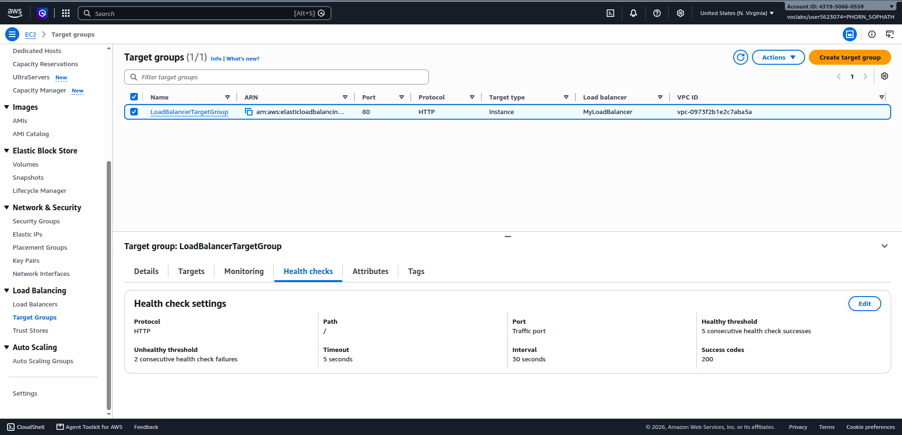

## Application Load Balancer

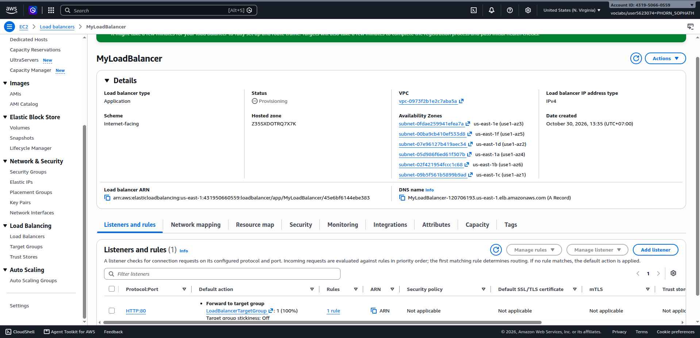

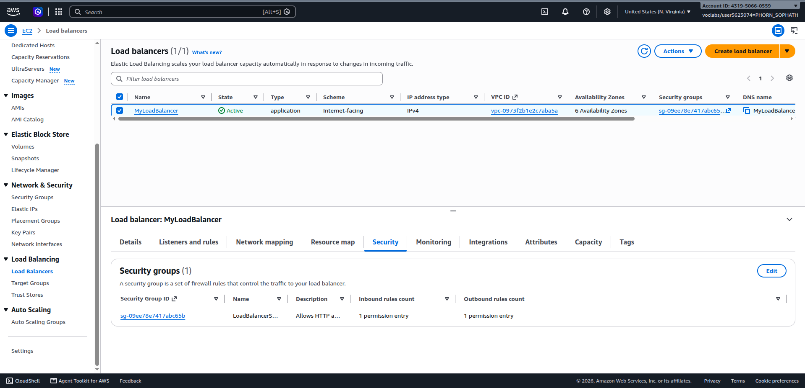

## Launch template

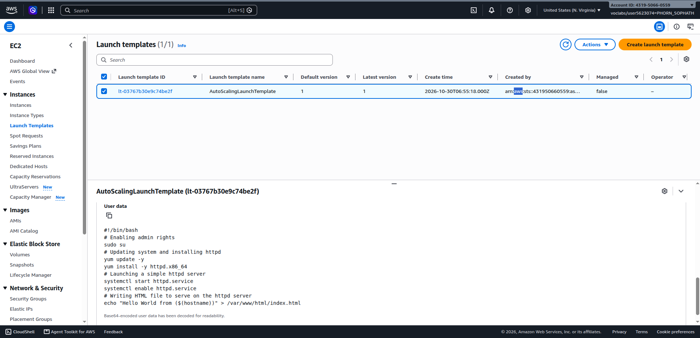

## Auto Scaling group

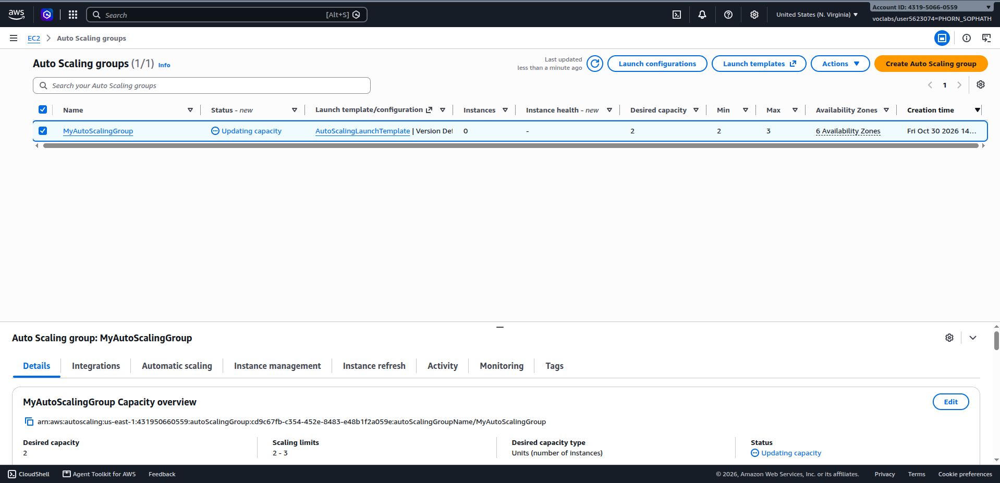

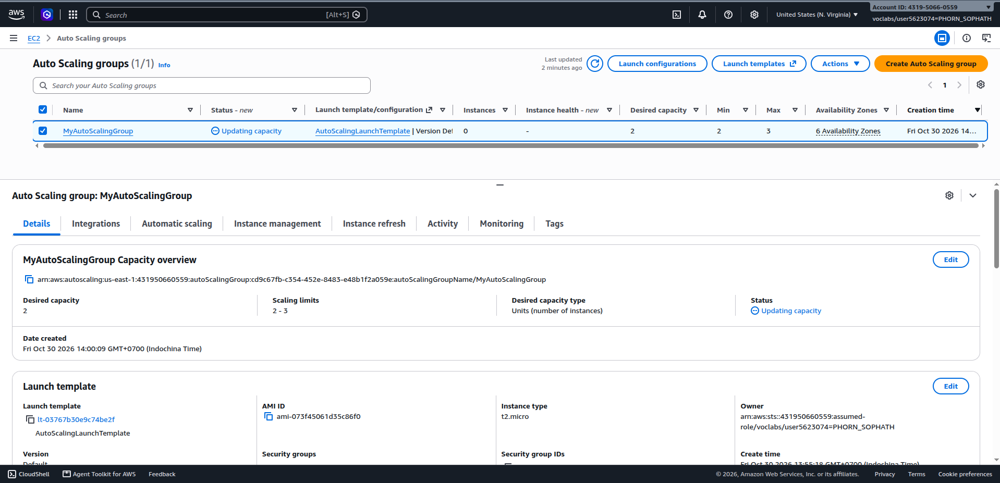

## Load balancing test


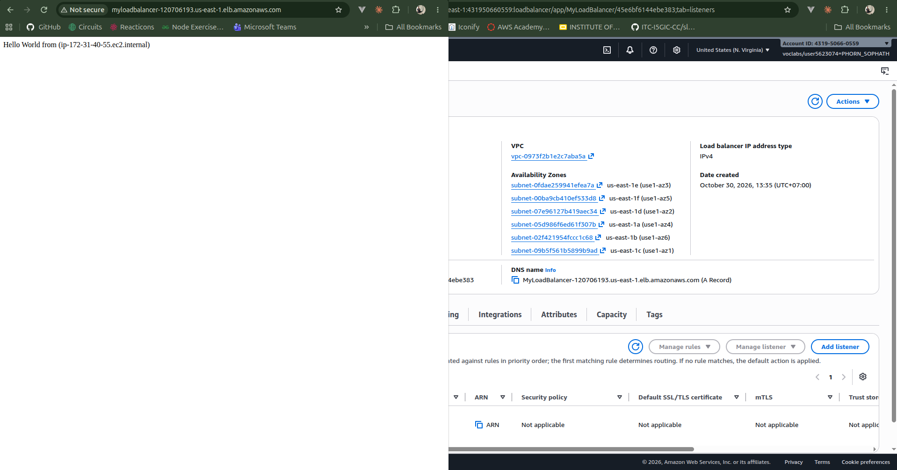

## Simulated application failure

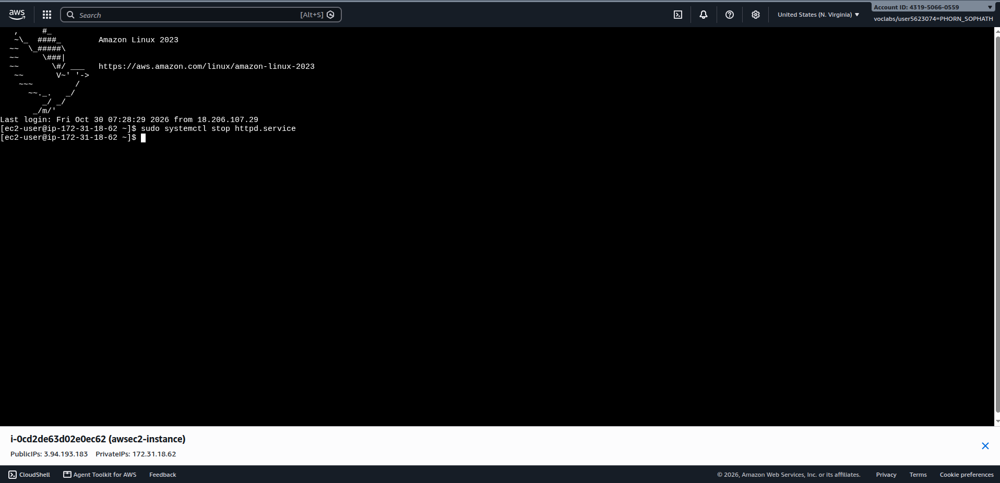

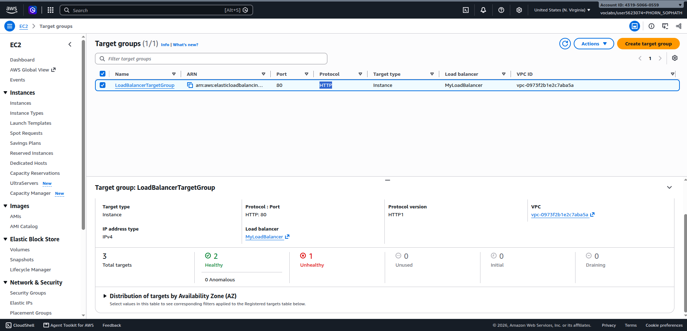

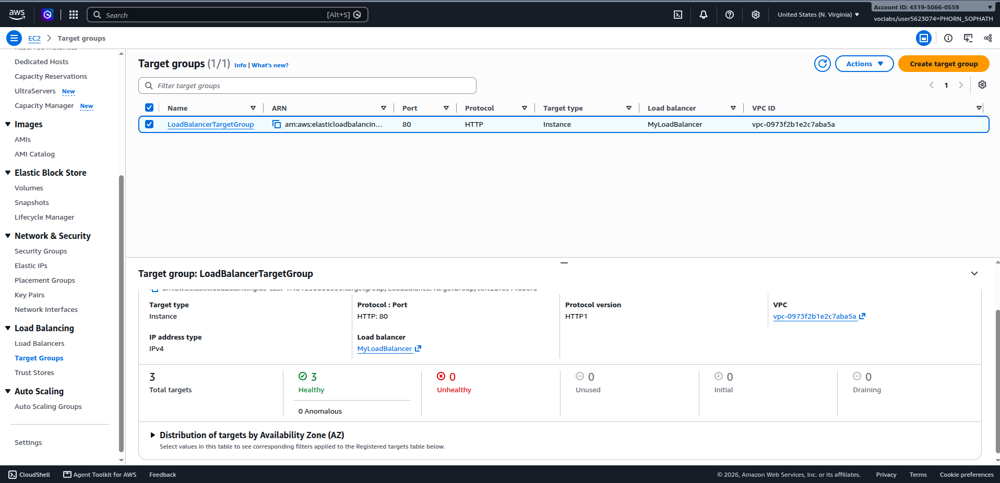

**About how many minutes passed between stopping `httpd` and the new instance becoming healthy?**

Approximately **8 to 10 minutes** passed between stopping `httpd` and the replacement instance becoming fully healthy:
1. **Detection (~1 minute):** The target group sends health check requests every 30 seconds. After 2 consecutive failed health checks (unhealthy threshold = 2), the target group marked the instance as `unhealthy`.
2. **Termination & Launch (~2 to 3 minutes):** The Auto Scaling group (configured with ELB health checks) detected the unhealthy status, placed the instance into `draining`/termination, and automatically triggered the launch of a new EC2 instance to maintain the desired capacity of 2.
3. **Initialization & User Data (~3 to 4 minutes):** The new instance booted up and executed its user data script to update packages, install and start the `httpd` web server, and create `index.html`.
4. **Health Check Registration (~1 to 2 minutes):** The target group registered the new target in `initial` state and performed consecutive successful health checks until marking it `healthy`.

---

## Questions

### 1. Why does the page show a different host name when you refresh it?

The Application Load Balancer (ALB) distributes incoming HTTP requests across all registered, healthy EC2 instances in its target group using a round-robin routing algorithm by default. 

During the launch template configuration, each instance executes a user data script that writes its own hostname into the web root:
```bash
echo "Hello World from ($(hostname))" > /var/www/html/index.html
```
When you access the ALB's DNS name and refresh the browser, successive HTTP requests are routed alternately between the different EC2 instances in the Auto Scaling group. As a result, each response displays the distinct private hostname of the specific instance that served that request.

---

### 2. After you stopped `httpd`, the instance was still *running* in EC2, but the target group marked it *unhealthy*. What did the health check test, and why did the instance fail it?

- **What the health check tested:** The Target Group performs an **Application Layer (Layer 7)** HTTP health check. Specifically, it sends periodic HTTP `GET` requests to port `80` at path `/` (every 30 seconds by default) and expects an HTTP `200 OK` response code.
- **Why the instance failed:** Standard EC2 status checks (System Status Check and Instance Status Check) only monitor infrastructure, hypervisor, OS kernel, and network reachability. When `sudo systemctl stop httpd.service` was run, the EC2 instance and operating system remained running and healthy at the infrastructure level. However, because the Apache HTTP web server daemon was stopped, no service was listening on port 80 to answer HTTP requests. The ALB received a connection refusal/timeout instead of an HTTP `200` status code. After reaching the configured threshold of 2 consecutive failures, the target group marked the instance as `unhealthy`.

---

### 3. Who replaced the failed instance: the load balancer, the target group, or the Auto Scaling group? Explain the role of each one.

The **Auto Scaling group (ASG)** replaced the failed instance.

The role of each component is as follows:
- **Application Load Balancer (ALB):** Acts as the single public entry point for client traffic. It evaluates listener rules, routes incoming requests only to healthy targets, and immediately stops directing client traffic to any instance flagged as unhealthy. It does not launch or terminate EC2 instances.
- **Target Group:** Acts as the health monitor and target registry. It regularly probes the registered targets via HTTP health checks, evaluates their application health, marks failed targets as `unhealthy`, and reports this health status to Elastic Load Balancing and the ASG.
- **Auto Scaling Group (ASG):** Manages EC2 instance lifecycle and capacity. Because **Elastic Load Balancing health checks** were enabled on the ASG, the ASG consumes the health status from the target group. Once notified that an instance has failed ELB health checks, the ASG terminates the unhealthy instance and launches a replacement instance using the `AutoScalingLaunchTemplate` to maintain the desired capacity of 2 instances.

---

### 4. With desired 2, minimum 2 and maximum 3, how many instances run normally? In what situation could there be 3?

- **Normal operation:** Exactly **2 instances** run normally because the **Desired capacity** is set to 2. Unless a scaling action or manual override occurs, the ASG consistently maintains 2 active running instances.
- **Situations where there could be 3 instances:**
  1. **Dynamic Scaling Policy:** If a scaling policy is configured (such as Target Tracking based on average CPU utilization or ALB request count per target), a surge in traffic will cause the ASG to scale out to its maximum capacity of **3 instances**.
  2. **Manual Capacity Adjustment:** If an administrator manually increases the desired capacity to 3 via the AWS Management Console or AWS CLI.
  3. **Instance Replacement / Refresh overlap:** During certain instance replacement or rolling update workflows where the ASG launches a replacement instance before terminating the existing one, a third instance may briefly exist before the old instance is completely terminated.

---

### 5. The instances' security group allows HTTP from anywhere. How could you change it so that the instances accept HTTP **only** from the load balancer?

To restrict HTTP traffic strictly to the load balancer:
1. Open the inbound rules of the instances' security group (`LaunchTemplateSecurityGroup`).
2. Locate the inbound rule for **HTTP** (port `80`).
3. Change the **Source** from `0.0.0.0/0` (Anywhere-IPv4) to the **Security Group ID of the Application Load Balancer** (`LoadBalancerSecurityGroup`, e.g., `sg-xxxxxxxxxxxxxxxxx`).
4. Save the rules.

By referencing the security group ID as the source, AWS security group chaining ensures that only network traffic originating from the Application Load Balancer can connect to port 80 of the EC2 instances, while blocking direct access from any other IP address on the public internet.

---

## Problems and how I solved them (optional)

- **Target Group Registration Delay:** When the Auto Scaling group first launched instances, targets initially appeared in the `initial` state before becoming `healthy`. Waiting approximately 2 to 3 minutes allowed the user data script to finish installing and starting `httpd` and for the target group to complete the required number of consecutive healthy checks.
- **Screenshot naming consistency:** Verified that screenshot 14 was named `14-target-replaced.png` to adhere to the grading script and submission requirements.

---

## AI note (optional)

Used AI assistance to review and verify the distinct architectural responsibilities among the Application Load Balancer (traffic distribution), Target Group (application-layer health monitoring), and Auto Scaling Group (lifecycle and instance replacement management), confirming how ELB health checks integrate with ASG replacement triggers.

---

## Clean up

- [x] `MyAutoScalingGroup` deleted and its instances terminated.
- [x] `AutoScalingLaunchTemplate` deleted.
- [x] `MyLoadBalancer` and `LoadBalancerTargetGroup` deleted.
- [x] Both security groups deleted.
