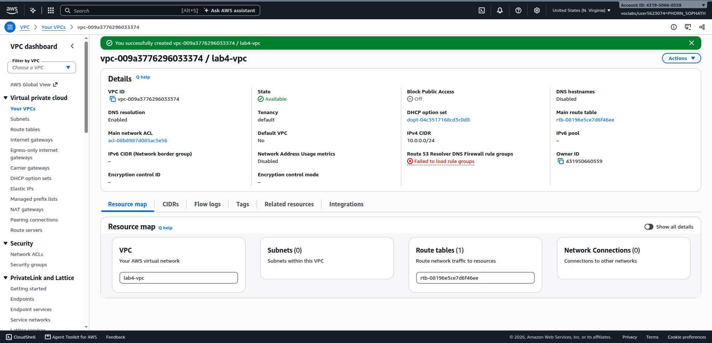
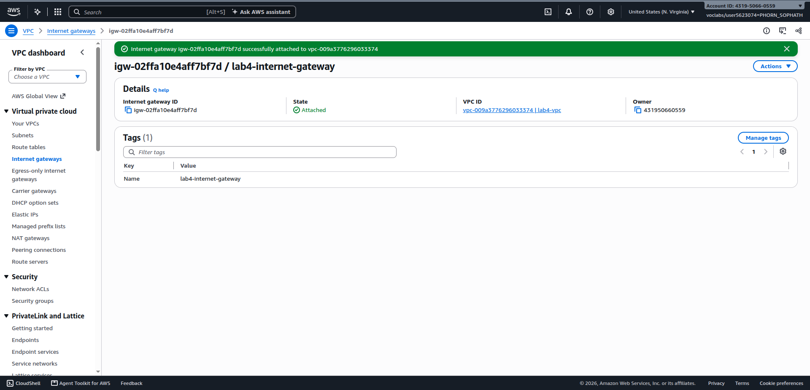
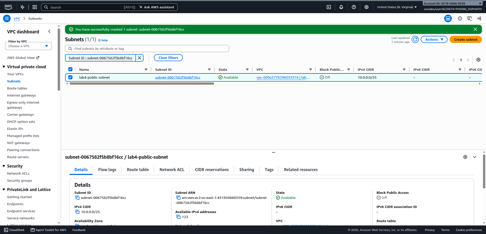
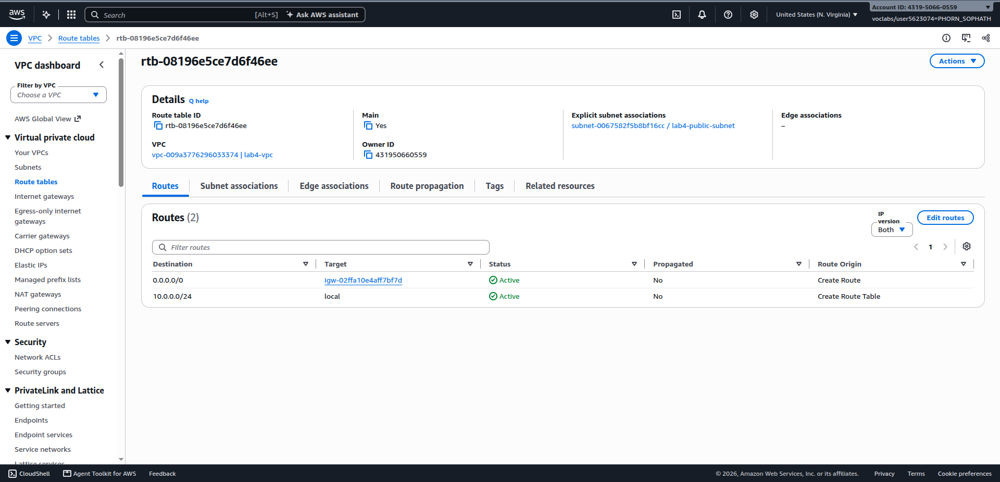
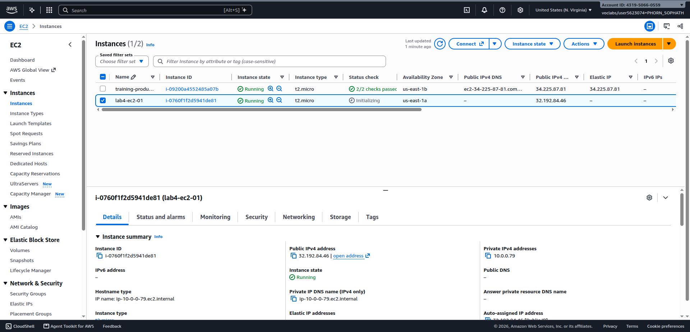
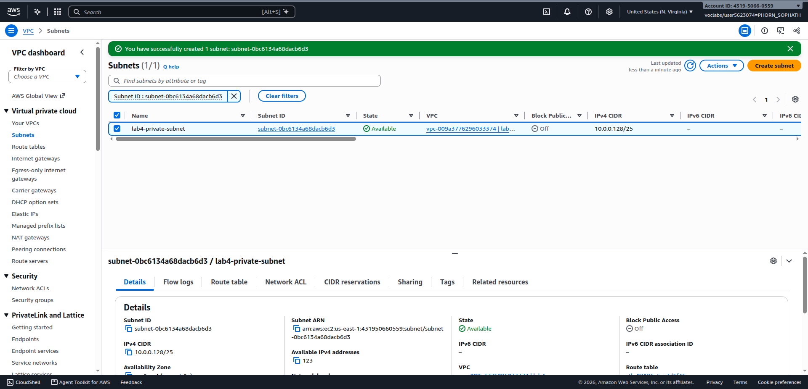
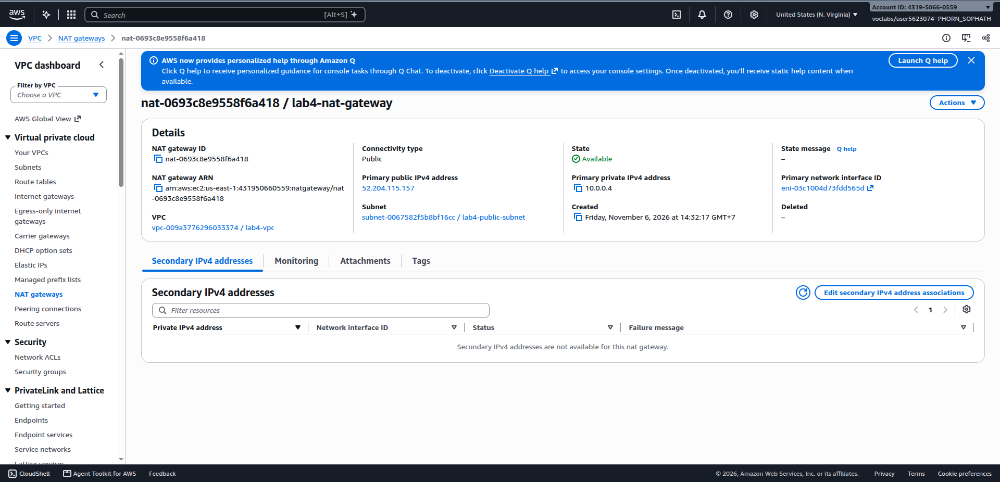
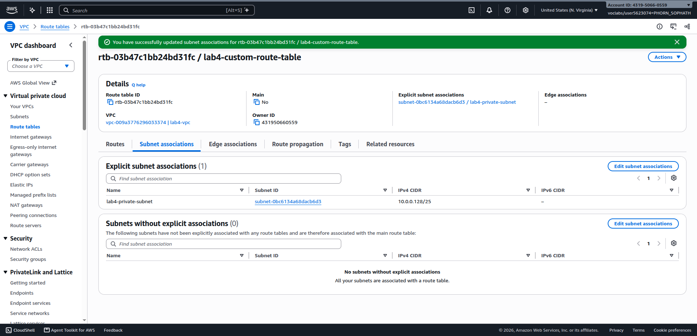
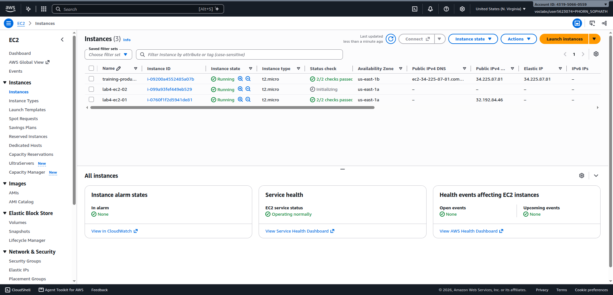
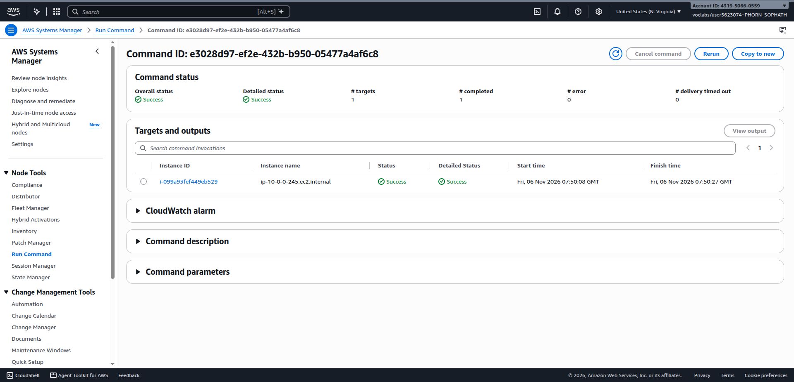

# Cloud Lab 4 Submission — Amazon VPC

Copy this template to `cc-lab-YOUR_ID/lab4/README.md` in your own repository. Follow [the instructions](lab4-instruction.md). Put your screenshots in `lab4/images/` with the file names below.

- **Student name:** PHORN Sophath
- **Student ID:** `e20220628`
- **Learner Lab user name:** `PHORN_SOPHATH`
- **Date completed:** 6 November 2026

---

## VPC and internet gateway

## Public subnet

## Private subnet

---

## Questions

### 1. The VPC is `10.0.0.0/24` and the subnets are `10.0.0.0/25` and `10.0.0.128/25`. How many IP addresses does each block contain, and why do the two subnets not overlap?

- **Number of IP addresses in each block:**
  - **VPC (`10.0.0.0/24`):**
    - Prefix: `/24` $\rightarrow$ Host bits: $32 - 24 = 8$ bits.
    - Total IP addresses: $2^8 = \mathbf{256}$ IP addresses (range: `10.0.0.0` – `10.0.0.255`).
  - **`lab4-public-subnet` (`10.0.0.0/25`):**
    - Prefix: `/25` $\rightarrow$ Host bits: $32 - 25 = 7$ bits.
    - Total IP addresses: $2^7 = \mathbf{128}$ IP addresses (range: `10.0.0.0` – `10.0.0.127`).
    - *AWS usable addresses:* AWS reserves 5 IP addresses in every subnet (network address `.0`, VPC router `.1`, DNS server `.2`, future use `.3`, and broadcast `.127`), leaving **123 usable IP addresses** for instances and elastic network interfaces.
  - **`lab4-private-subnet` (`10.0.0.128/25`):**
    - Prefix: `/25` $\rightarrow$ Host bits: $32 - 25 = 7$ bits.
    - Total IP addresses: $2^7 = \mathbf{128}$ IP addresses (range: `10.0.0.128` – `10.0.0.255`).
    - *AWS usable addresses:* Similarly, after subtracting the 5 AWS reserved IP addresses (`.128`, `.129`, `.130`, `.131`, and `.255`), there are **123 usable IP addresses**.

- **Why the two subnets do not overlap:**
  - The 25th bit (the most significant bit of the fourth octet) splits the `/24` block into two distinct, non-overlapping address spaces:
    - For `10.0.0.0/25`, the 4th octet begins with bit `0` (binary `00000000` to `01111111`, decimal `0` to `127`).
    - For `10.0.0.128/25`, the 4th octet begins with bit `1` (binary `10000000` to `11111111`, decimal `128` to `255`).
  - Because the prefix bit is fixed differently for each subnet, their IP address ranges are mutually exclusive. Together, they cleanly partition the parent VPC (`10.0.0.0/24`) without any overlap.

---

### 2. Both subnets are in the same VPC. What exactly makes `lab4-public-subnet` public and `lab4-private-subnet` private?

In AWS VPC, whether a subnet is considered "public" or "private" is determined strictly by its **route table configuration**:

- **`lab4-public-subnet` is public** because its associated route table contains a default route (`0.0.0.0/0`) targeting an **Internet Gateway (IGW)** (`lab4-internet-gateway`). Combined with public IP addresses assigned to instances, resources in this subnet can directly send traffic to and receive incoming connections from the public internet.
- **`lab4-private-subnet` is private** because its route table does **not** have a direct route to an Internet Gateway. Instead, its default route (`0.0.0.0/0`) points to a **NAT Gateway** (`lab4-nat-gateway`). Consequently, resources inside this subnet cannot be reached directly from the internet, protecting them from unsolicited external traffic while still permitting outbound connectivity.

---

### 3. Why is the NAT gateway placed in the **public** subnet and not in the private one?

A NAT (Network Address Translation) Gateway translates private IP addresses to a public IP so private resources can communicate with external internet services. For a NAT Gateway to perform this function, it must satisfy two requirements:
1. It must have a public IPv4 address (an allocated **Elastic IP**).
2. It must reside in a subnet whose route table routes internet traffic (`0.0.0.0/0`) directly to an **Internet Gateway (IGW)**.

Because only the **public subnet** has a route table directing traffic to the Internet Gateway, the NAT Gateway must be placed in the public subnet. If the NAT Gateway were placed in the private subnet:
- It would have no route to reach the Internet Gateway.
- Traffic sent from private instances to the NAT Gateway would reach a dead end and could not leave the VPC, making outbound internet communication impossible.

---

### 4. `lab4-ec2-02` has no public IP address. Can someone on the internet open a connection to it? Can it download updates? Explain both answers.

- **Can someone on the internet open a connection to it?**
  - **No.**
  - **Explanation:** `lab4-ec2-02` only has a private IPv4 address (`10.0.0.x`), which is unroutable across the public internet. In addition, `lab4-private-subnet` has no direct route to or from an Internet Gateway. An AWS NAT Gateway only provides one-way outbound Source NAT (SNAT); it does not support inbound port forwarding or unsolicited connection initiation from external internet hosts. Therefore, nobody on the internet can initiate a connection to `lab4-ec2-02`.

- **Can it download updates?**
  - **Yes.**
  - **Explanation:** When `lab4-ec2-02` runs an update command (e.g., `sudo yum update -y`), its outbound requests are sent according to the private subnet's route table, which routes `0.0.0.0/0` to `lab4-nat-gateway`. The NAT Gateway (located in the public subnet with an Elastic IP) translates the private source IP to its public Elastic IP and forwards the request out to the internet through the Internet Gateway. Because NAT is stateful, the NAT Gateway keeps track of the outgoing request and forwards the incoming return packets back to `lab4-ec2-02`. This allows the instance to download packages and patches successfully without having a public IP address.

---

### 5. You tested internet access with Systems Manager instead of SSH. Why did the instances need `LabInstanceProfile` for this?

- **Agent-based communication model:** Unlike SSH, which requires opening inbound port 22 in security groups and having a direct public IP or bastion host, **AWS Systems Manager (SSM)** uses the **SSM Agent** running inside the instance. The agent initiates *outbound* HTTPS connections to AWS Systems Manager API endpoints to register the instance, poll for commands, and return execution results.
- **Need for IAM credentials:** To authenticate and communicate with AWS Systems Manager service endpoints, the SSM Agent must have valid AWS credentials and IAM permissions (such as those provided by the `AmazonSSMManagedInstanceCore` managed policy).
- **Role of `LabInstanceProfile`:** An IAM instance profile is a container that passes an IAM role to an EC2 instance. Attaching **`LabInstanceProfile`** provides temporary security credentials to the instance via the EC2 Instance Metadata Service (IMDS). Without `LabInstanceProfile`, the SSM Agent cannot authenticate with the SSM service, and the instance will not register as a managed node or be capable of executing commands via SSM Run Command.

---

## Problems and how I solved them (optional)

- **Screenshot file naming standardization:** Initial screenshots had naming differences (`01.vpc.png`, `04-internet-gateway.png`, and `06-test-publick.png`). Renamed them to `01-vpc.png`, `04-public-route-table.png`, and `06-test-public.png` to strictly conform with the assignment's required directory structure and automated grading checks.
- **SSM Agent node registration time:** After launching instances with `LabInstanceProfile`, instances required a brief period (1–2 minutes) to complete initialization and register with Systems Manager Fleet Manager before appearing as available targets for Run Command.

---

## AI note (optional)

Used AI assistance to verify CIDR subnet block arithmetic (`/24` into two `/25` subnets), confirming total address capacity (128 addresses) versus AWS reserved addresses (123 usable), and to clearly explain stateful Source NAT (SNAT) behavior versus inbound traffic restrictions.

---

## Clean up

- [x] Instances terminated.
- [x] NAT gateway deleted and its Elastic IP released.
- [x] Internet gateway detached and deleted.
- [x] `lab4-vpc` deleted.

